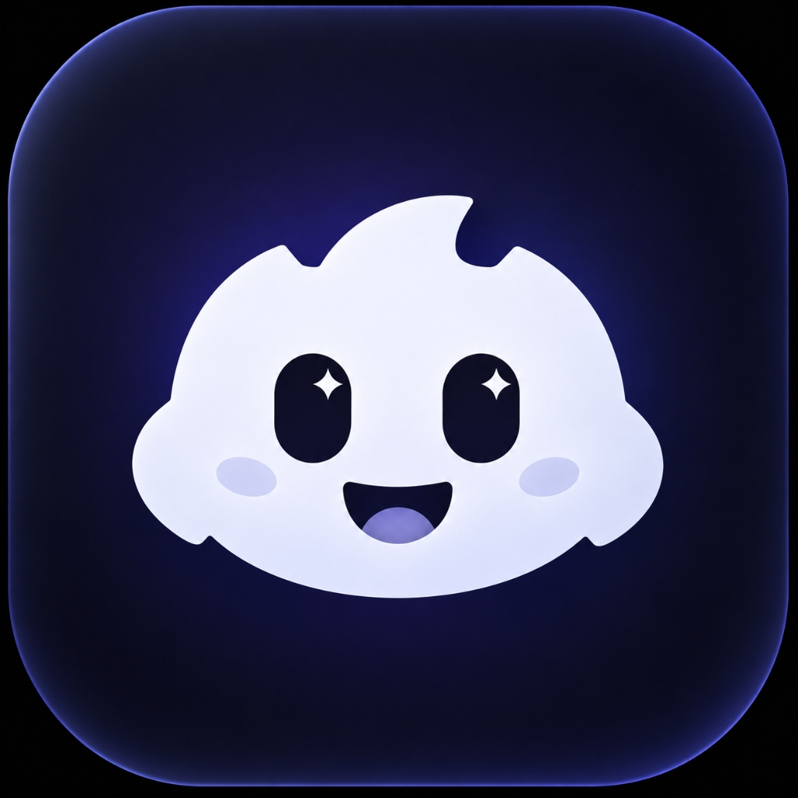

# Didcord

<p align="center">
  <a href="https://github.com/equalignorecase/Didcord">
    
  </a>
</p>

<p align="center">
  <strong>Native Discord desktop client น้ำหนักเบา เขียนด้วย Rust ขับเคลื่อนด้วย <code>egui</code> และ <code>wgpu</code></strong>
</p>

<p align="center">
  <a href="https://github.com/equalignorecase/Didcord/releases"></a>
  <a href="Cargo.toml"></a>
  <a href="crates/ui"></a>
  <a href="docs/platform-support.md"></a>
  <a href="LICENSE-MIT"></a>
</p>

---

> [!WARNING]
> **Unofficial Client และไม่ได้รับการรับรองจาก Discord**
> Didcord เชื่อมต่อโดยตรงกับ public gateway และ REST API ของ Discord สำหรับบัญชีที่มีอยู่แล้ว การใช้งาน client นอกเหนือจาก OAuth2/bot API อย่างเป็นทางการขัดต่อ Terms of Service ของ Discord และมีความเสี่ยงต่อการถูกระงับบัญชี โปรดอ่าน [ความเข้ากันได้ของโปรโตคอล](docs/discord-compatibility.md) และ [คู่มือการยืนยันตัวตน](docs/authentication.md) ก่อนใช้งาน

---

## จุดเด่น

- **Native Rust + egui/wgpu**: ไม่มี Electron, Node.js หรือ web runtime ใช้ RAM และ CPU ต่ำ (workspace ทั้งหมดห้าม `unsafe_code`)
- **Direct Gateway & REST**: เชื่อมต่อ Discord โดยตรง พร้อม rate-limit cooldown, heartbeat, reconnect/resume และ partial payload patching
- **OS Credential Store**: เก็บ session token ในระบบจัดการรหัสผ่านของ OS โดยอัตโนมัติ (Windows Credential Manager, macOS Keychain, Linux Secret Service) และ zeroize/redact ในหน่วยความจำ
- **Ephemeral Login Webview**: หน้า login ใช้ webview ชั่วคราวของระบบ (WebView2 / WKWebView / WebKitGTK) รองรับ email/password, QR code และ MFA แล้วปิดทันทีหลังได้ token
- **Bounded Local Cache**: เก็บประวัติแชท, draft, รูปภาพ และตั้งค่าใน SQLite แบบจำกัดเพดาน byte/item แยกตามบัญชี และลบข้อมูลออกเมื่อ logout
- **Native Voice & Video**: รองรับโทร 1-on-1, group DM และ server voice (Opus, DAVE v1 E2EE, Sonora AEC3, RNNoise, push-to-talk `V`, แชร์หน้าจอและกล้อง)
- **Extensions & Themes (Wasmi Sandbox)**: รองรับ plugin/theme แบบ sandbox (`Wasmi` ไม่มี WASI/native access) จำกัด fuel/memory และขออนุญาตผู้ใช้ก่อนทุก action

---

## การติดตั้งและ Build จาก Source

> [!NOTE]
> สามารถติดตามไฟล์ติดตั้งสำเร็จรูปได้ในหน้า [GitHub Releases](https://github.com/equalignorecase/Didcord/releases) ในอนาคต ปัจจุบันสามารถ build และรันจาก source ได้ทันที

### สิ่งที่ต้องมี (Prerequisites)

- **Rust `1.99.1`** (pinned ใน [rust-toolchain.toml](rust-toolchain.toml))
- **Git**, **CMake**, **NASM** และ **libclang** (ใช้ compile BoringSSL และ audio/video codecs)
- **Windows**: Visual Studio Build Tools (`Desktop development with C++`) และ WebView2 Runtime
- **macOS**: Xcode Command Line Tools (`xcode-select --install`)
- **Linux**: GCC/Clang, ALSA headers, `pkg-config`, GTK 4, WebKitGTK 6.0, `fontconfig`, Vulkan drivers (ดู [Platform Support](docs/platform-support.md))

### วิธี Build และรันบน Windows (PowerShell)

หากเครื่องมี `nasm.exe` อยู่ใน path ที่มีคำว่า `Microsoft` (เช่น WinGet WinLibs) หรือมี CMake 4.x ชนกับ `btls-sys` ให้ใช้ `Ninja` และ `CMake` ของ Visual Studio พร้อมย้าย `nasm.exe` ไปโฟลเดอร์ที่ไม่มีคำว่า `Microsoft`:

```powershell
# 1. โหลด environment ของ Visual Studio Build Tools
cmd /c "`"D:\VSBuildTools\VC\Auxiliary\Build\vcvars64.bat`" && set" | ForEach-Object {
  if ($_ -match '^([^=]+)=(.*)$') { [Environment]::SetEnvironmentVariable($matches[1], $matches[2], 'Process') }
}

# 2. ชี้ใช้ CMake และ Ninja ของ VS + nasm ที่ไม่อยู่ใน path ที่มีคำว่า Microsoft
$env:CMAKE = "D:\VSBuildTools\Common7\IDE\CommonExtensions\Microsoft\CMake\CMake\bin\cmake.exe"
$env:CMAKE_GENERATOR = "Ninja"
$env:PATH = "D:\tools\nasm;D:\VSBuildTools\Common7\IDE\CommonExtensions\Microsoft\CMake\Ninja;$env:PATH"
```

*(ปรับ path `D:\VSBuildTools` และ `D:\tools\nasm` ตามตำแหน่งที่ติดตั้งบนเครื่อง)*

### คำสั่งรัน

```sh
# 1. โหมด Demo (ใช้ข้อมูลจำลอง ไม่ต้อง login Discord)
cargo run --locked --features demo -- --demo

# 2. โหมด Client จริง (รวม Voice และ Login ผ่าน Webview)
cargo run --locked

# 3. Build เวอร์ชัน Release (ลื่นและกิน RAM น้อยกว่าโหมด Debug)
cargo build --release --locked
```

### คำสั่งสำหรับพัฒนาและตรวจสอบ

```sh
# ตรวจ format, Clippy, tests และ policy ทั้ง workspace
cargo xtask check

# สร้างแพ็กเกจ release
cargo xtask package

# รัน benchmark ของ state reducer
cargo replay

# ทดสอบ login handoff JS harness
node tests/login-handoff.cjs
```

ข้อมูลพัฒนาจะถูกแยกเก็บในโฟลเดอร์ `didcord-development` ของระบบ (หรือกำหนดเองผ่าน env `DIDCORD_DATA_DIR`) เพื่อไม่ปนกับตัวติดตั้งจริง

---

## โครงสร้าง Workspace

```text
didcord/
├── apps/
│   └── desktop/          # ตัวแอปหลัก, CLI flags, window lifecycle, updater
├── crates/
│   ├── client-core/      # State owner ฝั่ง UI, navigation, voice state
│   ├── session-cache/    # RAM cache (1 ช่องแชท, สูงสุด 500 ข้อความ / 4 MiB)
│   ├── ui/               # egui UI, viewport virtualization, themes, Markdown
│   ├── model/            # Domain entities, IDs, patches
│   ├── discord-protocol/ # Wire decoding และ DTOs แบบ bounded
│   ├── discord-api/      # REST client (wreq, TLS fingerprint, rate limit)
│   ├── discord-gateway/  # WebSocket Gateway (heartbeat, Identify/Resume)
│   ├── discord-voice/    # Voice/Video engine (Opus, DAVE/OpenMLS, AEC3, RNNoise)
│   ├── extensions/       # Wasmi extension sandbox และ SDK contract
│   ├── local-store/      # SQLite cache แบบ bounded แยกตามบัญชี
│   ├── platform/         # OS keyring, Wry login webview, file dialog, tray
│   ├── diagnostics/      # Opt-in bounded diagnostic logs (ไม่เก็บข้อมูลส่วนตัว)
│   └── test-support/     # Synthetic fixtures สำหรับเทสแบบ offline
└── tools/
    ├── replay-bench/     # Benchmark สำหรับ state reducers
    └── xtask/            # งานอัตโนมัติ (check, package)
```

---

## ความปลอดภัยและนโยบายจัดเก็บข้อมูล

- **การป้องกัน Token**: เก็บใน OS credential store เป็นหลัก และ redact/zeroize ในหน่วยความจำ; บน Linux จะใช้ไฟล์ plaintext โดยอัตโนมัติเฉพาะเมื่อยืนยันว่าไม่มี OS credential store เท่านั้น ไม่มีสวิตช์ opt-in และไม่ใช้ fallback เมื่อ store ถูกล็อก ทำงานผิดพลาด หรือหมดเวลา
- **Local Cache**: SQLite บน disk **ไม่ได้เข้ารหัส** แต่จำกัดขนาดและลบข้อมูลบัญชีออกทั้งหมดเมื่อกด Logout
- **ไม่มี Telemetry**: ไม่มีการเก็บสถิติ, analytics หรือส่ง crash report อัตโนมัติ
- **ไม่ปลอมแปลงตัวตนแบบสุ่ม**: ไม่ bypass CAPTCHA/MFA ไม่ดึง token จากแอปอื่น

อ่านรายละเอียดเพิ่มเติมได้ใน [Storage Policy](docs/storage-policy.md) และ [Threat Model](docs/threat-model.md)

หากย้ายมาจาก Serein หรือรุ่นที่ใช้ App ID เก่า ให้อ่าน [ข้อจำกัดการย้ายข้อมูลและ saved login](docs/platform-support.md#upgrading-from-an-earlier-app-identity) ก่อนเปลี่ยนรุ่น

---

## เอกสารเพิ่มเติม

- [Architecture & Monorepo Design](docs/architecture.md)
- [Discord Compatibility & Protocol Details](docs/discord-compatibility.md)
- [Authentication & Login Handoff](docs/authentication.md)
- [Storage Policy & Cache Retention](docs/storage-policy.md)
- [Platform Support & Build Requirements](docs/platform-support.md)
- [Voice Architecture & Procedure](docs/voice.md)
- [Design Tokens & UI Styling](docs/design.md)
- [Extensions & Plugin Architecture](docs/extensions.md)
- [Theme API Specification](docs/theme-api.md)
- [Threat Model & Security](docs/threat-model.md)
- [Third-Party Licenses & Notices](THIRD_PARTY_NOTICES.md)

---

## ลิขสิทธิ์และเครดิต (License & Credits)

**Didcord** พัฒนาต่อยอด (fork) จากโปรเจคต้นฉบับ **[Serein](https://github.com/ViceVerse-cz/Serein)**
โดยผู้ดูแลเวอร์ชัน Didcord คือ **equalignorecase** ([equalignorecase/Didcord](https://github.com/equalignorecase/Didcord))

ซอฟต์แวร์นี้เผยแพร่ภายใต้สัญญาอนุญาตแบบคู่ (**Dual License**) คุณสามารถเลือกใช้ได้ภายใต้:
- **MIT License** ([LICENSE-MIT](LICENSE-MIT))
- **Apache License, Version 2.0** ([LICENSE-APACHE](LICENSE-APACHE))

ลิขสิทธิ์โค้ดต้นฉบับยังคงเป็นของ **Serein contributors** (`Copyright (c) 2026 Serein contributors`) ตามที่ระบุใน [LICENSE-MIT](LICENSE-MIT) และรายการลิขสิทธิ์ของไลบรารี ฟอนต์ (Inter, Noto Sans CJK/Arabic) และกราฟิก Twemoji อยู่ใน [THIRD_PARTY_NOTICES.md](THIRD_PARTY_NOTICES.md)
